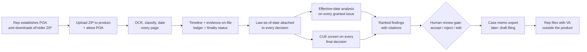

# The VA Effective-Date & CUE Engine — Product Spec, Viability, Monetization & Revenue

**Date:** 2026-10-09 · **Prepared with Claude** · **Status:** decision document (pre-build)

**Purpose.** This document explains, end to end and in plain language, what the proposed
"Effective-Date & CUE Engine" is, who it is for, what it does, and how it would be built; then
it judges whether it is worth building and how it would make money. It is written for a capable
product person, engineer, or investor with no background in veterans' benefits law. It builds on
two deep-research passes from July 2026 and re-verifies the facts that have most likely moved
since then.

---

## Contents

- [How to read the numbers](#how-to-read-the-numbers)
- **Part A — The product**
  1. [Executive summary](#1-executive-summary)
  2. [Domain primer for newcomers](#2-domain-primer-for-newcomers)
  3. [Problem and opportunity](#3-problem-and-opportunity)
  4. [Users and jobs-to-be-done](#4-users-and-jobs-to-be-done)
  5. [End-to-end product walkthrough](#5-end-to-end-product-walkthrough)
  6. [Scope](#6-scope)
  7. [Functional requirements](#7-functional-requirements)
  8. [UX overview](#8-ux-overview)
  9. [Technical requirements](#9-technical-requirements)
  10. [Legal and compliance constraints](#10-legal-and-compliance-constraints-on-the-product)
  11. [Risks, assumptions, open questions](#11-risks-assumptions-and-open-questions)
- **Part B — Should we build it?** 12. [Viability assessment](#12-viability-assessment) 13. [Monetization paths](#13-monetization-paths) 14. [Revenue model](#14-revenue-model) 15. [Recommendation and next steps](#15-recommendation-and-next-steps)
- [Appendices](#appendices) — A. Source map · B. Verification log · C. Change log vs. original spec

---

## How to read the numbers

Every number carries a provenance label:

| Label          | Meaning                                                                                    |
| -------------- | ------------------------------------------------------------------------------------------ |
| **[V]**        | Verified — traced to a primary or cited source                                             |
| **[CF Jul26]** | Carried forward from the July 2026 research passes; not re-checked today; still a snapshot |
| **[RV Oct26]** | Re-verified on the web for this document (2026-10-09)                                      |
| **[A]**        | Assumption — an input chosen for a model; change it and the output changes                 |
| **[E]**        | Estimate — derived from assumptions and/or verified inputs; arithmetic shown               |

Source shorthand used throughout: **R** = `REPORT.md`; **S** = `va-cue-rag-kb-system.md` (original
spec + Addendum); **F1** = `deep-research-findings-2026-07-16.md`; **F2** =
`deep-research-wedge-moat-2026-07-16.md`; **PV** = `phase-V-validation-checklist.md`. Web sources are
given as URLs.

---

# PART A — THE PRODUCT

## 1. Executive summary

**What it is.** Software for the lawyers and claims agents who represent veterans before the U.S.
Department of Veterans Affairs (VA). A representative uploads a veteran's complete VA claims file
— often 1,000–2,000+ pages of scanned documents — and the product reconstructs the veteran's
claims history as a dated timeline: every claim filed, every decision VA made, what evidence VA had
in hand on each date, and what the law said on each date. From that, it answers two money
questions:

1. **Did VA start paying this veteran later than the law allowed?** (The "effective date" question —
   it decides how much back pay the veteran is owed.)
2. **Is any old, final VA decision legally broken in a way that can still be reopened?** (The
   "Clear and Unmistakable Error," or CUE, question — the narrow legal route for overturning a
   decision that became final years or decades ago, with back pay running all the way back.)

The product finds candidates, shows its work with a citation to the exact page or regulation text
behind every statement, and leaves every judgment and every filing to the licensed human.

**Who pays.** VA-accredited attorneys and claims agents who charge fees — about **6,720 people**
**[CF Jul26; R §3, from Federal Register RIN 2900-AR94, Oct 2024]**. They are paid a contingency
fee, typically 20% of the veteran's past-due benefits, so a tool that finds an earlier effective
date directly increases what they earn. VA paid these professionals **$422.9M in fees over the
last 12 months** **[RV Oct26; VBA fee report, page updated 2026-10-06]**.

**Why it's worth money.** This analysis is done by hand today. A representative pages through a
huge scanned file, reconstructs the chronology, and then has to find the regulation _as it read on
the date of the old decision_, not today's text. It is slow, error-prone, and the most valuable
work in the practice.

**Why now.** VA's rules on representatives' access to veterans' electronic claims files were
revised and clarified by a final rule effective July 25, 2022 (38 C.F.R. §§ 1.600–1.603;
87 Fed. Reg. 37,744). That access is read-only apart from uploading new documents
**[V; citation-verifier 2026-10-09]**. Language models have made it practical to
read and structure thousand-page scanned files. And no tool on the market argues the earliest
effective date or tests for CUE.

**What it is not.** It does not represent veterans, talk to VA, file anything on its own, or sell
to veterans directly. It is decision support for an accredited professional who remains
responsible for the work.

**Headline verdict — build only if three conditions hold, and only as a founder-scale business.**
The need is real, the product can be built, and the gap in the market still exists as of today.
But:

- **The ceiling is small:** realistic Year-3 revenue is about **$1.0–1.3M ARR** **[E, §14]**.
- **The moat is thinner than the original spec claimed.** The historical regulation text it
  planned to own is freely available (including free Library of Congress scans for 1938–1995
  **[RV Oct26]**). What's left is the labor of turning it into accurate, date-exact data.
- **The closest competitor, VA Claim Helper (VCH), keeps moving toward this space.** Since July it
  has added structured claim histories pulled from the claims file and AI-flagged "reviewable
  issues" in past decisions **[RV Oct26]**.

**Confidence: moderate-low.** The three conditions:

1. Customer interviews confirm the pain and willingness to pay (the Phase V test).
2. Counsel confirms representatives may upload claims-file data to a third-party processor.
3. The product is reframed from "CUE engine" to an **effective-date engine with CUE as its premium
   module**. CUE wins are rare; effective-date questions come up on every case, which is what
   drives weekly use and retention.

---

## 2. Domain primer for newcomers

This section teaches only what is needed to understand the product. Legal citations are given so
an engineer can find the source; reading them is not required.

### 2.1 How VA disability compensation works

A veteran with a condition caused or worsened by military service can claim **disability
compensation**: a tax-free monthly payment from VA. VA decides whether the condition is
"service-connected" and assigns a **disability rating** from 0% to 100% in 10% steps. The payment
depends on the rating and the veteran's dependents. In 2026, a veteran with no dependents rated 70%
receives **$1,808.45/month**; at 100%, **$3,938.58/month** **[RV Oct26; va.gov current rates]**.

### 2.2 The claims file

Everything VA has about a veteran's claims lives in an electronic file in VA's system (VBMS). It is
called the **C-file** or **eFolder**. It holds service records, medical records, exam reports,
every form the veteran filed, every letter VA sent, and every decision. Files of 1,000–2,000+
pages are common, and much of it is scanned paper of mixed quality **[CF Jul26; S, F1 §2b]**.
VA records each document's **receipt date**: the date VA got it. That date matters later.

### 2.3 Decisions, appeals, and "finality"

VA's regional office issues a **rating decision**. The veteran has (generally) **one year** to
challenge it. Since February 19, 2019, under the Appeals Modernization Act (AMA), the routes are:

- a **Supplemental Claim**, with new evidence;
- a **Higher-Level Review**, where a senior reviewer takes a second look;
- an appeal to the **Board of Veterans' Appeals**.

Before 2019, the "legacy" system used a Notice of Disagreement and a Statement of the Case. If
nobody challenges a decision in time, it becomes **final**. After that, the ordinary routes are
closed for that decision. That is where CUE comes in.

### 2.4 The effective date, and why it is the money

The **effective date** is the day VA's payments start counting from. The general rule is the later
of the date VA received the claim or the date the entitlement arose, but many special rules can
push it earlier (38 U.S.C. § 5110; 38 C.F.R. § 3.400) **[V; S §1]**. Examples:

- claims filed within a year of leaving service;
- an "intent to file" notice that holds a date open;
- increases that were factually provable within the prior year;
- laws that later became more favorable ("liberalizing law," § 3.114);
- special Agent Orange rules (_Nehmer_, § 3.816).

When VA picks a date later than it should have, the veteran loses all the payments in between.
Moving an effective date back two years at 70% is worth over $43,000 **[CF Jul26; S Key Finding
2]**.

### 2.5 CUE — Clear and Unmistakable Error

**CUE** is the exception to finality. A final decision can be revised "at any time" if it contained
clear and unmistakable error. If it is revised, the correction takes effect **as if it had been made
on the original decision date**, so back pay runs from back then (38 C.F.R. § 3.105(a))
**[V; F1 §2c]**. The bar is deliberately high. The courts' three-part test (_Damrel v. Brown_,
6 Vet. App. 242, 245 (1994), quoting _Russell v. Principi_, 3 Vet. App. 310, 313–14 (1992)
(en banc)) **[V; citation-verifier 2026-10-09]**:

1. Either the correct facts, as they were known at the time, were not before the decision-maker,
   **or** the law in effect at the time was incorrectly applied;
2. the error is "undebatable" — not something reasonable minds could disagree about — **and** it
   would have **manifestly changed the outcome**; and
3. the finding must rest on **the record and the law that existed at the time** of the decision.

_Fugo v. Brown_, 6 Vet. App. 40, 43–44 (1993) adds that CUE is "a very specific and rare kind of
error" **[V]**.

Prong 3 creates the two constraints that make CUE hard, and they are the reason the product exists:

- **Only the record as it stood on the decision date counts.** Evidence that arrived later can't be
  used.
- **Only the law as it read on the decision date counts.** Today's version of the regulation can't
  be used.

The source of those rules depends on which body made the decision **[V; citation-verifier
2026-10-09]**:

- **Regional office decisions** — most of the product's targets: 38 C.F.R. § 3.105(a)(1)(iii),
  (iv) and (vi).
- **Board of Veterans' Appeals decisions:** 38 C.F.R. § 20.1403(b), (d) and (e).

Some theories are **categorically not CUE**: VA's failure in its duty to help gather evidence
(_Cook v. Principi_, 318 F.3d 1334 (Fed. Cir. 2002) (en banc)), a disagreement over how VA weighed
the evidence, a later change in diagnosis, or a later change in how the law is interpreted
(§ 3.105(a)(1); § 20.1403(d)–(e)) **[V]**. CUE is rare, and representatives
themselves say most old decisions are not CUE (Hill & Ponton public commentary)
**[RV Oct26, search snippet]**.

**CUE is not the same as _Nehmer_.** _Nehmer_ is a separate, court-ordered Agent Orange
effective-date rule (§ 3.816). The product must treat them as distinct mechanisms **[V; R §5]**.

### 2.6 Who represents veterans, and how they get paid

Only people **accredited by VA's Office of General Counsel** may help veterans with claims, and
only accredited **attorneys** and **claims agents** may charge for it (38 U.S.C. § 5904; 38 C.F.R.
§§ 14.629–14.637) **[V; S §5]**.

- **Who they are:** about 6,200 attorneys and 520 agents are fee-eligible **[CF Jul26]**. Another
  ~9,705 service-organization representatives (DAV, VFW, county veteran service officers, and
  similar) help for free and cannot charge fees **[V; CRS R46428, 2020 count]**.
- **When fees are allowed:** only after VA's initial decision.
- **How much:** usually 20% of past-due benefits, which VA withholds and pays the representative
  directly. A 20% fee is presumed reasonable (§ 14.636) **[V; F1 §6]**.
- **Getting on a case:** a representative is appointed by power of attorney (POA). Once appointed,
  they can view and bulk-download that veteran's eFolder, read-only, under §§ 1.600–1.603
  **[V; F1 §2b]**.

### 2.7 Why "the law as it read then" is hard

Regulations change. § 3.105 alone was amended about ten times between 1961 and 2019
**[V; F2]**. A decision dated March 15 needs the text in force on March 15, which can differ from
both the annual printed editions on either side of it. Annual snapshots are therefore not good
enough; the real requirement is **day-level** accuracy **[V; R §5 correction]**. The table shows
how far free sources reach.

| Period       | Free source               | Granularity          | What it takes to use                                                        |
| ------------ | ------------------------- | -------------------- | --------------------------------------------------------------------------- |
| 2017–today   | eCFR point-in-time API    | Day-level            | Ingest directly **[V; F1 §2a]**                                             |
| 1996/97–2016 | GovInfo bulk XML          | One edition per year | Reconcile mid-year changes against Federal Register effective dates **[V]** |
| 1938–1995    | Library of Congress scans | One edition per year | OCR, then the same reconciliation **[RV Oct26]**                            |

Proposed rules that never took effect must be excluded. The research found one: a 2007 rewrite,
E7-9542 (72 Fed. Reg. 28,770, May 22, 2007), one installment of a multi-rule proposed rewrite
into a new Part 5 that never took effect, so the exclusion problem spans several proposed rules
**[V; F2; citation-verifier 2026-10-09]**.

### 2.8 A worked example (illustrative; fictional veteran)

This simplified example follows one fictional veteran and shows what the product does at each
step. Whether a real case qualifies as CUE depends on facts a lawyer must judge.

| Date       | Event (in the eFolder)                                                                                                                                                                                                                                                                                       |
| ---------- | ------------------------------------------------------------------------------------------------------------------------------------------------------------------------------------------------------------------------------------------------------------------------------------------------------------ |
| 2008-03-10 | VA receives a letter from "Dana Reyes" saying she has had nightmares and panic since her deployment and wants VA benefits for it.                                                                                                                                                                            |
| 2008-04-02 | VA mails her the formal application.                                                                                                                                                                                                                                                                         |
| 2009-01-20 | VA receives her formal application for PTSD (within one year of the form being sent).                                                                                                                                                                                                                        |
| 2009-08-14 | Rating decision: PTSD service-connected at 70%, **effective 2009-01-20** (the formal-claim date).                                                                                                                                                                                                            |
| 2010-08-16 | No notice of disagreement filed. The one-year deadline runs from the date VA _mailed notice_ (assumed here to be 2009-08-14); it fell on Saturday 2010-08-14 and rolled to Monday 2010-08-16 under 38 C.F.R. § 20.305 (2009). After that day the decision is final (§§ 3.104(a), 20.302(a), 20.1103 (2009)). |
| 2026       | Dana hires an accredited attorney about a different issue. The attorney downloads her eFolder and runs it through the product.                                                                                                                                                                               |

**What the product does with it:**

1. **Timeline.** It builds the timeline above and links each row to its page in the file.
2. **Evidence on file at the time.** It confirms the 2008 letter was in the file before the 2009
   decision, using VA's receipt date.
3. **The law as it read then.** It retrieves §§ 3.1(p), 3.155(a) and 3.400(b)(2)(i) as they read
   on 2009-08-14. Under
   the pre-2015 rule, "any communication ... indicating an intent to apply" could be an informal
   claim if it identified the benefit sought, and a formal application filed within one year of VA sending the form kept the
   informal-claim date. VA replaced that rule with mandatory standard forms effective
   March 24, 2015, so today's text would give the wrong answer **[V; 79 Fed. Reg. 57,660 (2014);
   verified by citation-verifier 2026-10-09]**.
4. **Earliest effective date.** It calculates 2008-03-10 as a candidate effective date, against the
   2009-01-20 date VA assigned. Because the claim came more than a year after separation, the
   effective date is the later of the claim date and the date entitlement arose (§ 3.400(b)(2)(i)),
   so the candidate also depends on medical evidence in the file showing PTSD before 2008-03-10.
5. **CUE screen.** It flags the 2009 decision as a CUE candidate: the law in effect may have been
   misapplied, and the result would have changed by about 10 months. CUE is the route because the
   assigned effective date became final; there is no freestanding claim for an earlier effective
   date once a decision is final (_Rudd v. Nicholson_, 20 Vet. App. 296 (2006)). It also flags the
   weak point for the attorney. If the 2008 letter's meaning is debatable, this is a disagreement
   about weighing evidence, which is not CUE.
6. **The value.** At today's 70% rate, 10 months is at most 10 × $1,808.45 = **$18,084.50**
   **[E]**. The 2008–09 rates were lower, so the real figure is smaller. It also assumes PTSD was
   at the 70% level for the whole period; if the record supports a lower rating for part of it
   (a "staged" rating), the figure drops further. The attorney's 20% fee would be under about
   $3,600 **[E]**.

**The scale contrast.** The same machinery applied to a wrongly _denied_ claim from the 1990s
can produce decades of back pay. For example, 30 years at an assumed average of $1,000/month is
**$360,000** **[E from A]**. Such cases are rare, but they are where specialist firms make their
reputations.

### 2.9 Glossary

| Term                                    | Meaning                                                                                                                |
| --------------------------------------- | ---------------------------------------------------------------------------------------------------------------------- |
| Accredited representative               | A person approved by VA's Office of General Counsel (OGC) to help claimants; only attorneys and agents may charge fees |
| AMA / legacy                            | The post-Feb-19-2019 appeals system / the system before it                                                             |
| C-file / eFolder                        | The veteran's complete electronic claims file in VBMS                                                                  |
| CUE                                     | Clear and Unmistakable Error — the route to revise a final decision retroactively (§ 3.105(a))                         |
| Effective date                          | The date payments start counting from                                                                                  |
| Evidence of record                      | What was in the file on a given date (by VA receipt date)                                                              |
| Finality                                | Status of a decision that was not challenged in time                                                                   |
| HLR / Supplemental Claim / Board appeal | The three AMA review routes                                                                                            |
| ITF                                     | Intent to File — a notice that preserves an effective date while a claim is prepared                                   |
| _Nehmer_                                | Court-ordered Agent Orange effective-date rule (§ 3.816); not CUE                                                      |
| NOVA                                    | National Organization of Veterans' Advocates — the main professional association (~850 members) **[CF Jul26]**         |
| POA                                     | Power of attorney appointing a representative (Forms 21-22 / 21-22a)                                                   |
| Point-in-time law                       | A regulation's text as it read on a specific past date                                                                 |
| VBMS / eFolder Express                  | VA's claims system / its bulk-download feature for accredited reps                                                     |
| VSO                                     | Veterans Service Organization; its representatives work for free                                                       |

---

## 3. Problem and opportunity

**How the work is done today.** An attorney or agent, often with a paralegal:

1. downloads the eFolder as a ZIP of mixed PDF, TIFF and image files **[V; F1 §2b]**;
2. reads it page by page to rebuild the chronology;
3. works out which decisions are final;
4. for each candidate error, works out what was in the file on that date;
5. then hunts for the old regulation text, in paid research databases (HeinOnline and ProQuest
   Regulatory Insight carry every CFR edition since 1938 **[RV Oct26; Boston College law guide]**),
   in print, or from memory.

The research found this work delivered as bespoke specialist legal labor **[CF Jul26; F1 §4]**.
Advocates describe 6,000-page manual record reviews **[RV Oct26; Superinsight case study,
Apr 2026]**.

**Why it goes wrong:**

- The chronology is buried in scans.
- Receipt dates and document dates differ.
- The old regulation text is hard to get.
- Evidence that arrived later quietly contaminates the analysis.
- The CUE exclusions are counterintuitive: a strong-feeling argument is often legally barred.
- A missed earlier effective date is invisible. Nobody knows the money was left behind.

**Value at stake.** Effective-date corrections are worth thousands to hundreds of thousands of
dollars per veteran (§2.8). To the representative, 20% of that is pure added fee. Across the
profession, VA pays $422.9M a year in fees **[RV Oct26]**. That is the veterans' money and the
representatives' income, **not** the vendor's market. The vendor's market is bounded by the
number of paying professionals **[V; R §4]**.

**The gap.** Of the tools deeply checked (VCH, Vala, VeteranAi, Dodonai), none argues the earliest
effective date, tests decisions for CUE, or applies point-in-time law **[CF Jul26; F2]**. VCH, the
closest, was re-checked today and still doesn't. It has moved closer, though (see §12.4)
**[RV Oct26]**.

---

## 4. Users and jobs-to-be-done

| User                                                      | Context                                                                               | Job to be done                                                                                                                  | Pains                                                                              | "Done well" looks like                                                                                                                                                                                                                                                                 |
| --------------------------------------------------------- | ------------------------------------------------------------------------------------- | ------------------------------------------------------------------------------------------------------------------------------- | ---------------------------------------------------------------------------------- | -------------------------------------------------------------------------------------------------------------------------------------------------------------------------------------------------------------------------------------------------------------------------------------- |
| **Primary: solo/boutique accredited attorney or agent**   | 1–5 people; contingency income; high caseload; often already pays for VCH-class tools | "On every new case, tell me whether this veteran is owed an earlier date or has a CUE claim, fast enough that I actually check" | Time; not knowing what they missed; getting old law; fear of AI-invented citations | A 10-minute review of a ranked findings list in which every line links to its proof                                                                                                                                                                                                    |
| **Primary: specialist CUE / effective-date practitioner** | Takes referred "hard" cases; deep expertise                                           | "Build the full record-and-law-at-the-time picture for this decision so I can draft a motion I'd stake my name on"              | Hours of reconstruction per case; finding exact historical text                    | A defensible evidence and law packet for the decision date, which they then draft from                                                                                                                                                                                                 |
| **Secondary: paralegal / case manager**                   | Does intake and file prep                                                             | "Get the file in, clean, and organized"                                                                                         | Bad scans; misfiled documents                                                      | Upload, then a processed case with flagged problem pages                                                                                                                                                                                                                               |
| **Secondary (later): VSO organizations**                  | Free representation at high volume; budget-limited; cannot charge fees                | "Screen thousands of files for missed effective dates"                                                                          | Volume; little senior attorney time                                                | Batch screening that routes the best candidates to senior staff                                                                                                                                                                                                                        |
| **Non-user: veterans directly**                           | —                                                                                     | —                                                                                                                               | —                                                                                  | Excluded. Charging veterans for claim help without accreditation is barred (§ 5904), CUE requires legal judgment, and the false-hope and fraud risk is high. Veteran self-help tools exist (VeteranAi at $25/mo) **[CF Jul26]**, but that is a different and legally riskier business. |

---

## 5. End-to-end product walkthrough

**Before (today):**

```
POA established → rep downloads eFolder ZIP → reads 1,000–2,000 pages → builds chronology by hand
→ decides which decisions are final → for each suspect decision: reconstructs what was in the file,
hunts for the old regulation text → judges CUE / effective date → drafts the filing → files
```

**After (with the product):**



| Step               | Who           | What the system does                                                                | What the human decides           | Artifact             |
| ------------------ | ------------- | ----------------------------------------------------------------------------------- | -------------------------------- | -------------------- |
| 1. Get the file    | Rep           | — (VA access is the rep's own, read-only)                                           | Whether they hold POA            | eFolder ZIP          |
| 2. Upload + attest | Rep/paralegal | Stores the file encrypted and records the POA attestation                           | —                                | Case record          |
| 3. Process         | System        | OCR, page typing, date extraction, quality flags (minutes)                          | Fix flagged pages if needed      | Indexed file         |
| 4. Timeline        | System        | Builds events, decisions, issues, finality, and the evidence-on-file ledger         | Correct mistakes                 | Interactive timeline |
| 5. Law             | System        | Attaches the regulation text in force on each decision date, with its source        | —                                | Law-at-date panel    |
| 6. Analyze         | System        | Effective-date candidates and CUE hypotheses, filtered against the legal exclusions | —                                | Findings list        |
| 7. Review          | Rep           | Shows each finding's reasoning, citations, and confidence                           | Accept, reject, or edit each one | Reviewed findings    |
| 8. Export          | Rep           | Generates a memo (MVP); a draft motion later                                        | Final edits and signature        | Memo or draft        |
| 9. File            | Rep           | Nothing; the product never contacts VA                                              | Everything                       | Filing               |

---

## 6. Scope

**Goals:**

- Cut the time to a reliable effective-date and CUE assessment from hours to minutes of review.
- Make it routine to check every case, not just suspected ones.
- Have zero fabricated authorities in any finding a user can export.

**Non-goals, each with its reason:**

- **No autonomous filing or contact with VA.** The accredited user is legally responsible (§ 14.632)
  and legal-RAG error rates are high.
- **No vendor-held VA system access.** Access is the representative's personal, per-POA right
  **[V; F1 §2b]**.
- **No selling to veterans** (§4).
- **No condition-spotting, form-filling, or deadline calendars.** These are commodity features VCH
  and others already sell **[RV Oct26]**. Integrate with them instead of rebuilding them.
- **No drafting of legal filings in the MVP.** It carries high liability, so it comes later and
  behind the evaluation gate **[S Addendum]**.

**Phases.** These follow the Addendum's sequence, with three deliberate departures:

| Phase                   | Scope                                                                                                                                    | Gate to exit                                                      |
| ----------------------- | ---------------------------------------------------------------------------------------------------------------------------------------- | ----------------------------------------------------------------- |
| V — Validate (2–4 wks)  | Interviews, commercial-corpus check, competitor check (PV), **plus counsel's opinion on third-party processing of eFolder data** _(new)_ | All pass (§15)                                                    |
| 0 — Foundation (3–6 mo) | Ingestion pipeline on real files; law corpus thin slice; design partners                                                                 | Corpus slice accurate to the day; ≥1 design partner on real files |
| 1 — MVP (3–4 mo)        | Timeline + effective-date analysis + CUE screen + law-at-date + review gate + memo export; evaluation harness                            | Accuracy bars in §7 met; partner confirms hours saved             |
| 2 — Depth (6–9 mo)      | Broader corpus back to the 1980s; retro-pay calculator with historical rates; Board decision retrieval; gated drafting                   | Paying customers; accuracy holds at volume                        |
| 3 — Scale               | Firm and VSO tiers; batch screening; integrations (VCH-class tools, Clio)                                                                | Retention and accuracy metrics hold                               |

**The three departures from the Addendum:**

1. **Effective-date analysis becomes a core MVP module**, not a footnote to CUE. It applies to every
   case, which drives frequency of use.
2. **A counsel-opinion gate is added in Phase V.**
3. **The law corpus thin slice targets the sections that drive effective dates** (§§ 3.105, 3.155,
   3.156, 3.400, 3.114, 3.816) across the dates design partners actually need, not an arbitrary
   section.

---

## 7. Functional requirements

Each requirement lists: what it is, why it exists, how it could be implemented, acceptance
criteria, phase, and risks. Acceptance thresholds are **[A]** starting targets, to be set from
baseline measurements in Phase 0. "F#" refers to the original spec's features.

### A. Ingestion and case setup (F9, revised)

**FR-1 — Import a VA eFolder export.** The system accepts the eFolder Express ZIP, or loose
PDF/TIFF/image files, up to at least 5,000 pages per case.

- _Why:_ VA offers no API; the representative's own bulk download is the only lawful path
  **[V; F1 §2b]**.
- _How:_
  - resumable upload direct to encrypted object storage;
  - unpack in an isolated worker;
  - normalize everything to page images plus PDF;
  - parse the filename and metadata conventions of the eFolder Express export (to be mapped in
    Phase 0).
- _Accept:_ 100% of pages accounted for, with a page-count reconciliation report; a 2,000-page file
  is ingested in under 15 minutes.
- _Phase:_ 0.
- _Risk:_ The export format is undocumented and may change. Mitigate with a format-detection test
  suite built from real files.

**FR-2 — OCR with page-level provenance.** Every page gets text, word-level positions, and a
quality score. Unreadable pages are flagged, never silently dropped.

- _Why:_ Every downstream citation points to a page and a passage, and bad scans are common.
- _How:_
  - a commercial OCR service (cloud document AI) with a fallback engine;
  - store the per-word bounding boxes;
  - quality scored from OCR confidence plus a language-model sanity check;
  - handwriting flagged for manual review.
- _Accept:_ ≥99% character accuracy on typed pages in a 200-page benchmark; 100% of
  low-confidence pages surfaced to the user.
- _Phase:_ 0.

**FR-3 — Document typing and dating.** Each document is classified (rating decision, code sheet,
notification letter, SOC/SSOC, NOD/decision-review form, claim form, ITF, C&P exam, service
records, private medical, correspondence, Board/court decision, other). The system extracts both
the **document date** and VA's **receipt date**.

- _Why:_ Evidence-on-file and effective-date logic run on receipt dates; the reasoning runs on
  document types.
- _How:_ VA form numbers and headers as strong signals; a fine-tuned or prompted classifier for the
  rest; receipt date taken from eFolder metadata or a date-stamp detector; disagreements between
  sources are flagged.
- _Accept:_ ≥97% type accuracy on rating decisions and claim forms; ≥98% receipt-date accuracy where
  metadata exists.
- _Phase:_ 0–1.
- _Risk:_ If the export lacks receipt-date metadata, accuracy depends on stamp detection (an open
  question in §11).

**FR-4 — Case setup with POA attestation.** A case can't be processed until the user attests to an
active POA and records its date and scope.

- _Why:_ Access is limited to claimants who appointed the user (§§ 1.600–1.603); this is a
  compliance record.
- _How:_ A required form plus an optional upload of the 21-22/21-22a; recorded in the audit log.
- _Accept:_ Processing is blocked without the attestation.
- _Phase:_ 1.

### B. Timeline and record (F1 + F5)

**FR-5 — Event extraction.** The system extracts every claim (formal, informal, ITF),
decision, notice, appeal or review request, and evidence receipt as dated events linked to source
pages.

- _Why:_ This is the substrate for everything else.
- _How:_
  - a structured-extraction pass per document type with a JSON schema;
  - deduplication across copies (VA files often contain duplicates);
  - each event stores both its source page and the exact source text it came from.
- _Accept:_ ≥95% recall of rating decisions and claim filings against hand-built timelines for 25
  real files.
- _Phase:_ 1.

**FR-6 — Decision decomposition.** Each decision is split into issues. For each issue, the system
captures: outcome, rating %, diagnostic code, the effective date assigned, the stated reasons, the
evidence the decision lists, and the law it cites.

- _Why:_ CUE and effective dates are argued issue by issue, not decision by decision.
- _How:_ Rating decisions follow consistent templates (code sheet plus narrative), so use
  template-aware extraction with a cross-check between the code sheet and the narrative.
- _Accept:_ ≥98% accuracy on effective date and rating % per issue.
- _Phase:_ 1.

**FR-7 — Finality status.** For each issue, the system computes whether and when it became final.
The rules differ by system: legacy (appeal periods, receipt of new and material evidence within the
year) or AMA (one-year windows, continuous pursuit under § 3.2500(c), (h)(1)). Uncertain cases are shown as
"undetermined — here's why."

- _Why:_ CUE applies only to final decisions; continuous pursuit preserves effective dates.
- _How:_ A deterministic rules engine over the event graph, never the language model. Each rule
  cites its point-in-time source.
- _Accept:_ ≥90% correct on the gold set; 100% of the rest flagged as undetermined.
- _Phase:_ 1.

**FR-8 — Evidence-on-file ledger.** For any date, the system lists every document in the file as
of that date.

- _Why:_ This enforces CUE's record-at-the-time rule mechanically, so the model never decides it.
- _How:_ A query over receipt dates, with documents that have uncertain dates shown separately.
  Doctrines under which VA is treated as holding records it didn't physically have are modeled as
  explicit, counsel-reviewed rules (scope to confirm).
- _Accept:_ The ledger matches hand review on 25 files.
- _Phase:_ 1.

**FR-9 — Interactive timeline.** Every event can be clicked through to its page image with the
source passage highlighted. Users can correct, add, or hide events, and the corrections flow
downstream.

- _Why:_ This is how users build trust, and human corrections are required.
- _How:_ A virtualized list over the event table; corrections are stored as user overrides (never
  edits to extracted data) and re-trigger dependent analyses.
- _Accept:_ Every event resolves to its source page in under 2 s; a correction re-runs the
  affected findings and marks them changed.
- _Phase:_ 1.

### C. Point-in-time law (F3)

**FR-10 — Law as of a date.** Given a regulation section and a date, the system returns the text
in force that day, its source edition, the Federal Register citation and effective date of the
governing amendment, and a coverage status.

- _Why:_ This is the core CUE constraint **[V; § 3.105(a)(1)(iii) for regional office decisions;
  § 20.1403(b) for Board decisions]**.
- _How:_
  - a versioned store keyed by section, with effective-from and effective-to dates;
  - eCFR versioner for 2017 onward;
  - GovInfo annual XML for 1996/97–2016, plus Federal Register amendment reconciliation;
  - Library of Congress scans, OCR'd, for 1938–1995;
  - every version is human-verified before it is marked "verified."
- _Accept:_ For scoped sections, 100% agreement with a hand-verified test set of 50
  section-and-date pairs. Unverified dates return "not verified," never a guess.
- _Phase:_ 0 (thin slice), 1, 2 (breadth).

**FR-11 — Version history and diff.** The system shows how a section changed between two dates,
with each change attributed to its Federal Register rule.

- _Why:_ Users need to see why the law differed, and it helps them build their argument.
- _How:_ A word-level diff between consecutive LawVersion records, labeled with each version's FR
  citation.
- _Accept:_ The diff for any two dates matches the hand-verified versions in the FR-10 test set.
- _Phase:_ 1.

**FR-12 — Corpus hygiene and coverage map.** The system tracks proposed versus final rules,
publication versus effective dates, and court-ordered invalidations. It publishes a coverage map
of which sections are verified for which date ranges.

- _Why:_ The research caught a proposed rule (E7-9542) that never became law **[V; F2]**. A
  false "this was the law" is the worst possible error.
- _Accept:_ Every version record carries a source citation and a verification status.
- _Phase:_ 0+.

### D. Effective-date analysis (F4, broadened into a core module)

**FR-13 — Earliest-effective-date analysis.** For each granted issue, the system finds every
candidate date the record supports under each applicable rule:

- the earliest claim communication (applying the informal-claim rules in force at the time);
- an ITF;
- a claim within one year of separation;
- the date entitlement arose;
- a factually provable increase within the prior year (§ 3.400(o)(2));
- liberalizing law (§ 3.114);
- continuous pursuit.

It then compares the earliest supportable date to the assigned date.

- _Why:_ This applies to every case; it is the product's high-frequency value.
- _How:_
  - rules-first: each rule is an encoded test over the event graph and the law-as-of-date;
  - the language model is used only to read documents for evidence each rule needs (e.g., "does
    this letter express intent to claim PTSD?"), with quotes;
  - output is ranked by the size of the gap and the strength of the evidence.
- _Accept:_ Recovers ≥90% of known date errors in the gold set; every candidate cites the rule
  version and the evidence page.
- _Phase:_ 1.

**FR-14 — Special-regime flags.** The system flags fact patterns for _Nehmer_ (§ 3.816) and other
special effective-date regimes as flags only, kept separate from CUE.

- _Why:_ These are high value and easy to miss; conflating them with CUE is an error **[V; R §5]**.
- _How:_ Rules over service records (dates and places of service, covered conditions) that emit a
  flag with its anchors, not an argument.
- _Accept:_ ≥90% recall on a seeded set of _Nehmer_ fact patterns; never labeled as CUE.
- _Phase:_ 1–2.

### E. CUE analysis (F2)

**FR-15 — CUE candidate screen.** For each final decision and issue, the system generates CUE
hypotheses of the two permitted kinds: correct facts not before the adjudicator, or law
misapplied. Each is tested against the three-part test using **only** the FR-8 ledger for that
date and **only** the FR-10 law for that date.

- _Why:_ This is the core differentiator.
- _How:_
  - **Constrained context:** the model receives only the evidence-on-file and law-as-of-date
    packets, so later evidence cannot leak in.
  - **Structured output** for each hypothesis: alleged error, rule in force, quoted record facts, a
    "why undebatable" argument, an outcome-change analysis, and a confidence level.
  - **Adversarial second pass:** a separate reviewer prompt tries to refute each hypothesis.
- _Accept:_ On a gold set built from Board decisions that ruled on CUE motions (see §9.6):
  - ≥85% recall of CUE theories the Board found valid;
  - ≥60% precision **[A]**.
    The two are weighted differently because a missed theory is invisible while a false positive costs
    only review time.
- _Phase:_ 1.

**FR-16 — Exclusion filter.** The system automatically classifies, and demotes or rejects with
an explanation, theories that are categorically barred: duty-to-assist failures, disagreement over
how evidence was weighed, a later diagnosis, a later change in interpretation (§ 3.105(a)(1)(iv),
(vi) for regional office decisions; § 20.1403(d)–(e) for Board decisions).

- _Why:_ These are the most common losing arguments **[S F2]**, and the filter teaches users as
  well as protecting them.
- _Accept:_ 100% of the barred-category test cases are caught.
- _Phase:_ 1.

**FR-17 — Prior-CUE detection.** The system detects earlier CUE motions or adjudications on the
same decision and theory, which may bar refiling, and surfaces them prominently.

- _Why:_ CUE on a given theory is often a one-shot remedy **[S Key Finding 2]**.
- _How:_ Match prior CUE motions and decisions in the timeline to the current decision and theory.
- _Accept:_ 100% of prior CUE adjudications in the gold set are surfaced on the matching finding.
- _Phase:_ 1.

**FR-18 — Outcome impact.** For each viable candidate, the system shows the corrected outcome, the
corrected effective date, and the size of the gap in months.

- _Why:_ This covers the "manifestly changed outcome" prong and lets the user triage by value.
- _How:_ Re-run the effective-date and rating rules with the corrected input, then compare.
- _Accept:_ The month gap matches a hand calculation on every gold-set finding.
- _Phase:_ 1.

### F. Money

**FR-19 — Retro-pay estimate.** The system estimates back pay from the corrected date using
historical VA rate tables (rating × dependents × year) and shows the 20% fee.

- _Why:_ Lets the user prioritize, and makes the ROI visible.
- _How:_ A versioned rate-table dataset built from VA's past-rates pages.
- _Accept:_ Within 2% of a hand calculation on 20 cases.
- _Phase:_ 2 (the MVP shows only the month gap).

### G. Trust: citations, review, audit

**FR-20 — Anchored assertions only.** Every factual or legal statement in a finding must carry at
least one anchor: a page and passage, or a law version and passage. Statements without anchors
can't be shown as findings.

- _Why:_ Legal-RAG tools hallucinate at roughly 17–33% **[CF Jul26; Stanford via F1]**. This is
  the core trust mechanism.
- _Accept:_ 0 unanchored statements in exported output, enforced in code.
- _Phase:_ 1.

**FR-21 — Citation verification.** The system checks mechanically that every quoted passage
appears verbatim in its anchor. Case citations are checked against a maintained list of known
authorities (name, reporter, year, a confirmed one-line holding); unknown ones are marked
"unverified — check before use."

- _Why:_ Catches fabrication before a human ever sees it.
- _Accept:_ 0 fabricated citations among accepted findings on the gold set.
- _Phase:_ 1.

**FR-22 — Human review gate.** Findings move through Proposed → Accepted / Rejected / Edited. The
reviewer's identity and timestamp are recorded. Only accepted findings can be exported, and exports
carry a "reviewed by [user]" statement and a disclaimer.

- _Why:_ The § 14.632 competence duty sits with the user; this also produces training signal.
- _Phase:_ 1.

**FR-23 — Audit log.** An append-only record of uploads, attestations, views, analyses (with model
and corpus versions), decisions, and exports.

- _Why:_ Supports security reviews, malpractice defense, and reproducibility.
- _Phase:_ 1.

### H. Outputs

**FR-24 — Case memo export.** The system produces a DOCX/PDF memo containing the timeline, the
accepted findings, the law-at-date excerpts, and source page references.

- _Why:_ This is the MVP deliverable; it fits existing workflows without the liability of drafting
  filings.
- _How:_ A templated document rendered from accepted findings and their anchors.
- _Accept:_ Contains only accepted findings; every statement in it carries a page or law
  reference.
- _Phase:_ 1.

**FR-25 — Draft filings (gated).** The system drafts a CUE motion, Supplemental Claim, HLR request,
or Board brief from accepted findings only.

- _Why:_ It saves real time, but carries high liability.
- _How:_ Instrument templates filled only from accepted findings, with the FR-21 checks re-run on
  the draft.
- _Accept:_ 0 unanchored statements and 0 unverified citations in a 50-draft review by design
  partners.
- _Phase:_ 2, and only after FR-15/21 accuracy holds at volume **[S Addendum]**.

### I. Platform

**FR-26 — Security and tenancy:**

- per-firm tenant isolation and role-based access;
- multi-factor authentication, plus single sign-on for firms;
- encryption in transit and at rest;
- configurable retention with deletion on request;
- no training on client data without written opt-in.
- _Phase:_ 0–1.

**FR-27 — Usage metering:** case and credit counters per account for billing (§13). _Accept:_
metered counts reconcile exactly with the audit log. _Phase:_ 1.

**FR-28 — Batch screening:** run the effective-date and CUE screen across many files and rank
them. _Accept:_ 500 files screened overnight; the ranking reproduces the single-file findings.
_Phase:_ 3 (the VSO and firm tier).

**Cut or deferred from the original spec:**

- **F7, condition and secondary-condition spotting:** commodity; integrate rather than build.
- **F8, appeal-route recommender and deadline guard:** VCH already has multi-claim deadline
  tracking and calendars **[RV Oct26]**; deferred to Phase 3, if at all.

---

## 8. UX overview

**Information architecture:** Firm → Cases → Case. A case has five tabs:

- **Overview**
- **Timeline**
- **Findings**
- **Law**
- **Documents**

plus an account-level **Review Queue**.

**Core screen 1 — Case Overview:**

```
┌ Reyes, Dana ─ POA attested 2026-09-30 ─ 1,842 pages ─ 12 pages need attention ┐
│ FINDINGS (3 proposed)                         value     strength   status      │
│ ▸ Earlier eff. date: PTSD 2009-01 → 2008-03   ~10 mo    ●●●○       Proposed    │
│ ▸ CUE candidate: 2009 rating decision (law    ~10 mo    ●●○○       Proposed    │
│   misapplied — §3.155 as of 2009-08-14)                                        │
│ ▸ Nehmer flag: none                                                            │
│ [Review findings]   [View timeline]   [Export memo — 0 accepted]               │
└────────────────────────────────────────────────────────────────────────────────┘
```

**Core screen 2 — Timeline:** a vertical, date-ordered list with filters (claims / decisions /
evidence / appeals). Each row shows the date, type, a one-line summary, and a page link. Final
decisions get a "FINAL since …" badge. Hovering over a decision shows "what VA had on file":
a count, expandable to the list.

**Core screen 3 — Finding detail (the review gate):**

```
┌ CUE candidate · 2009-08-14 rating decision · Issue: PTSD effective date ─────────────┐
│ CLAIM: VA assigned 2009-01-20; record supports 2008-03-10 under §3.155(a) as in force │
│ on 2009-08-14.                                                                        │
│ ┌ Record at the time ───────────┐ ┌ Law at the time (verified ✓) ───────────────────┐ │
│ │ p.212 "…want VA benefits for  │ │ 38 CFR 3.155(a) [ed. 2008; no amendments to     │ │
│ │ the nightmares since Iraq…"   │ │ 2009-08-14] "Any communication or action,       │ │
│ │ received 2008-03-10 ↗         │ │ indicating an intent to apply…" ↗               │ │
│ └───────────────────────────────┘ └──────────────────────────────────────────────────┘ │
│ Three-part test:  error ✓ arguable   undebatable ⚠ contested   outcome change ✓ 10 mo│
│ ⚠ Weak point: if the letter's meaning is debatable, this is a weighing dispute       │
│   (not CUE). Consider whether the earlier-date argument has another route.           │
│ Rebuttal pass: "…" ↗                                                                 │
│ [Accept] [Edit] [Reject: reason ▾]                                                   │
└───────────────────────────────────────────────────────────────────────────────────────┘
```

**Design principles:**

- **Show the evidence first.** The two-column "record then / law then" layout makes CUE's two hard
  constraints visible.
- **Confidence is shown as a reason, not a percentage.** "⚠ contested: why," because a bare
  "73%" invites misplaced trust.
- **Every claim is one click from its source page,** with the passage highlighted.
- **Unverified law is shown in grey and labeled "not verified for this date."** It is never
  silently substituted.

**Error and empty states:**

- Unreadable pages are listed with a "re-upload or mark irrelevant" action.
- "No rating decisions found" asks the user to check that the ZIP is the complete eFolder.
- Undetermined finality is shown as an explicit badge with the reason.
- Zero findings is shown as a positive result: "No earlier date or CUE candidates found under N
  rules checked." The list of what was checked matters, because "nothing found" must be
  auditable.

**Onboarding:** a sample redacted case ships preloaded. The first-run flow covers: upload → a
processing progress view (minutes) → the guided review of one finding. The goal is a reviewed
finding within the first session.

---

## 9. Technical requirements

### 9.1 Reference architecture

```
Browser (React) ──HTTPS──► API (auth, tenancy, audit) ──► Job queue
                                                     │
      ┌──────────────────────────────────────────────┼─────────────────────────────┐
      ▼                                              ▼                             ▼
 Ingestion workers                         Analysis workers                 Law-corpus service
 unzip → normalize → OCR → classify →      rules engine (finality, eff.     versioned sections,
 date → extract events                     date, ledger) + constrained      eff-from/to, provenance,
      │                                    LLM calls (CUE, evidence reads)  verification status
      ▼                                              │                             │
 Object store (page images, encrypted)       Case graph DB (Postgres:            Postgres + full-text
 + page text with word boxes                 events/decisions/issues/            (+ optional vector
                                             findings/anchors)                   index for retrieval)
                                                     │
                                         Citation verifier + review gate → Export service
```

**Choices and why:**

- **Postgres** as the system of record, with an event and issue graph modeled relationally. It is
  auditable, cheap, and good at recursive queries; a dedicated graph database isn't needed at this
  scale.
- **Rules engine for anything legal-deterministic:** finality, ledger cut-offs, and date
  arithmetic. The language model is used only for reading and arguing, inside constrained
  contexts.
- **Retrieval by structure first** (section ID plus date, or document type plus date), with vector
  search as a secondary aid, because legal correctness depends on exact matches.
- **Model-agnostic LLM layer** with the model and prompt version recorded per run (FR-23). A
  mid-tier model handles bulk extraction; a frontier model handles CUE reasoning and the rebuttal
  pass.

### 9.2 Core data model

| Entity           | Key fields                                                                                   |
| ---------------- | -------------------------------------------------------------------------------------------- |
| Case             | tenant, claimant ref (no SSN in clear text), POA attestation, status                         |
| Document / Page  | type, document date, receipt date (+ source), OCR text, word boxes, quality                  |
| Event            | type (claim/ITF/decision/notice/review/evidence), date, document anchor                      |
| Decision → Issue | issue, outcome, rating %, diagnostic code, assigned effective date, finality status + reason |
| LawVersion       | section, text, effective from/to, FR citation, source edition, verification status           |
| Finding          | kind (eff-date / CUE / Nehmer), claim, structured test results, confidence + reason, status  |
| Anchor           | finding → (page + text span) or (LawVersion + text span)                                     |
| AuditEvent       | actor, action, object, model/corpus versions, timestamp                                      |

### 9.3 Data sources and corpora

| Corpus                      | Source                                                             | Coverage                                 | Cost / licensing                  | Status                            |
| --------------------------- | ------------------------------------------------------------------ | ---------------------------------------- | --------------------------------- | --------------------------------- |
| 38 C.F.R., 2017–now         | eCFR versioner API                                                 | Day-level                                | Free                              | **[V; F1]**                       |
| 38 C.F.R., 1996/97–2016     | GovInfo bulk XML                                                   | Annual + Federal Register reconciliation | Free                              | **[V; F1]**                       |
| 38 C.F.R., 1938–1995        | Library of Congress digital collection                             | Annual scans → OCR                       | Free (U.S. Government work)       | **[RV Oct26]**                    |
| Same, commercial            | HeinOnline; ProQuest Regulatory Insight                            | Every edition since 1938                 | Paid; API and day-level unknown   | **[RV Oct26]** existence only     |
| Federal Register amendments | federalregister.gov API (1994+); older issues digitized on GovInfo | Per rule                                 | Free                              | 1994+ **[V]**; pre-1994 to verify |
| 38 U.S.C. history           | U.S. Code prior editions (GovInfo / House OLRC)                    | Annual                                   | Free                              | To verify                         |
| Board decisions             | Board site search (search.usa.gov)                                 | Large, redacted                          | Free; **no bulk download listed** | **[RV Oct26; data.gov]**          |
| CAVC / Fed. Cir. opinions   | Court websites, public case-law sources                            | Precedential opinions                    | Free                              | To verify                         |
| VA rate tables              | va.gov current and past-rate pages                                 | By year                                  | Free                              | 2024–26 **[RV Oct26]**            |
| VA manual M21-1             | KnowVA                                                             | Current + history (unclear)              | Free                              | Point-in-time history to verify   |

**Critical scoping decision:** don't digitize all of 38 C.F.R. history. Build day-accurate
histories for the roughly 30–60 sections that drive effective dates and CUE (Part 3 claim,
effective-date, revision and finality rules) plus the rating criteria for the 10–20 most-litigated
conditions **[A]**. Expand as customers ask for more.

### 9.4 Ingestion pipeline

Unzip and inventory → convert TIFF and images to PDF pages → OCR → page-quality scoring → document
segmentation (eFolder files can bundle several documents) → classification → date extraction
(metadata, then stamp, then text) → event extraction → deduplication.

The pipeline must be idempotent and resumable, and must record per-page provenance.

### 9.5 Reasoning design

- **Rules-first:** finality, the evidence ledger, and effective-date rules are code, versioned
  alongside the law corpus.
- **Constrained LLM contexts:** CUE prompts receive only the as-of-date record and law packets,
  enforced at retrieval, so later evidence cannot leak in.
- **Structured outputs** with a required anchor for every claim; the FR-20/21 checks run after
  generation.
- **Adversarial rebuttal pass,** which keeps a candidate only if it survives its strongest
  rebuttal.
- **Report "checked and found nothing" explicitly,** listing which rules and decisions were tested.

### 9.6 Evaluation

**Gold sets** **[A — designs to validate in Phase 0]**:

- **(a) 25 real, consented files** with timelines built by hand by design partners. Used for
  FR-5/6/7/8 and FR-13.
- **(b) A CUE reasoning set from Board decisions that adjudicated CUE motions.** Each such decision
  states the prior decision, the alleged error, the law, and the outcome: free, labeled,
  issue-level data. It has to be crawled through the Board's search, since no bulk download is
  listed **[RV Oct26]**.
- **(c) 50 hand-verified section-and-date pairs** for FR-10.

**Metrics:**

- extraction recall and precision;
- date accuracy;
- finality accuracy;
- CUE recall and precision;
- fabricated-citation rate (target 0 post-gate);
- reviewer acceptance rate;
- time-to-reviewed-finding.

**Regression:** every model, prompt, or corpus change reruns all sets, and releases are blocked on
regression.

### 9.7 Security, privacy, compliance architecture

- **Data:** C-files contain Social Security numbers, medical records, and records that federal law
  protects specially (38 U.S.C. § 7332 covers drug/alcohol, HIV, and sickle-cell records)
  **[V; S §5]**. Required controls:
  - encryption at rest with per-tenant keys;
  - TLS 1.2+ in transit;
  - private networking;
  - least-privilege staff access with break-glass auditing;
  - field-level masking of Social Security numbers in the UI.
- **LLM providers:** only providers with zero-data-retention terms and a signed data processing
  agreement; no use of client data for training. A business associate agreement (BAA) is available
  if firms require one.
- **Certifications:** SOC 2 Type I by first firm-tier sale, Type II within 12 months **[A]**. Pen
  test before general availability. A firm security-questionnaire packet.
- **Retention:** firm-configurable; default delete 90 days after case closure **[A]**.
- **Boundary:** the product never holds VA credentials and never connects to VA systems.

### 9.8 Non-functional requirements

| Area            | Target                                                                       |
| --------------- | ---------------------------------------------------------------------------- |
| Processing time | ≤15 min for a 2,000-page file; analysis ≤10 min **[A]**                      |
| Availability    | 99.5% (business tool; batch-tolerant) **[A]**                                |
| Reproducibility | Every finding re-runnable from the logged model, prompt, and corpus versions |
| Scale           | Hundreds of cases a day in Year 1; trivially horizontally scalable           |
| Auditability    | Every export traceable to a reviewer and to its sources                      |

### 9.9 Build versus buy

- **Buy:** OCR, the LLM APIs, cloud infrastructure, authentication, billing.
- **Ingest free:** the regulation corpora, Board decisions, and rate tables.
- **Build:**
  - the eFolder ingestion and dating pipeline;
  - the legal rules engine;
  - the curated day-accurate law dataset;
  - the evaluation sets;
  - the review UX.
- **Defensibility comes from the curated dataset, the rules engine, and the evaluation sets**, not
  from the model.

### 9.10 Cost of goods per case **[E from A]**

| Component                                   | Assumption                                                          | Cost / case                                              |
| ------------------------------------------- | ------------------------------------------------------------------- | -------------------------------------------------------- |
| OCR                                         | 2,000 pages at ~$1.50 per 1,000 pages **[A]**                       | ~$3                                                      |
| Bulk extraction LLM pass                    | ~1.5M tokens on a mid-tier model at ~$1–3/M blended **[A]**         | ~$2–5                                                    |
| CUE and effective-date reasoning + rebuttal | ~5 decisions × ~150K tokens on a frontier model at ~$5–15/M **[A]** | ~$5–20                                                   |
| Storage, compute, egress                    | —                                                                   | ~$1–2                                                    |
| **Total**                                   |                                                                     | **~$11–30**; plan on **$20–50** with retries and re-runs |

At an assumed 25 full workups per account per year, cost of goods is roughly $500–1,250 per account
per year **[E]**. Against a base-case revenue of ~$4,875 per account (§14), that leaves a gross
margin of about **75–90%** before support. Model and OCR prices are assumptions, to be benchmarked
in Phase 0.

---

## 10. Legal and compliance constraints on the product

| Constraint                                                                                                                                                                                                                                                 | Source                                                                                                                                                                                                                                                                               | Design / marketing consequence                                                                                                                                                                                               | Status                         |
| ---------------------------------------------------------------------------------------------------------------------------------------------------------------------------------------------------------------------------------------------------------- | ------------------------------------------------------------------------------------------------------------------------------------------------------------------------------------------------------------------------------------------------------------------------------------ | ---------------------------------------------------------------------------------------------------------------------------------------------------------------------------------------------------------------------------- | ------------------------------ |
| Only accredited attorneys and agents may charge claimants for claim help; the vendor is neither                                                                                                                                                            | 38 U.S.C. § 5904; 38 C.F.R. § 14.636                                                                                                                                                                                                                                                 | Sell only to accredited users; never market as representation or to veterans; verify accreditation at signup (OGC roster)                                                                                                    | **[V]**                        |
| The vendor can't share in claimant fees                                                                                                                                                                                                                    | § 14.636 fee regime + accreditation framework (whether § 5904 itself bars fee-sharing with a non-representative is unverified — counsel); § 14.632(c)(5) is only a general "clearly unreasonable or otherwise prohibited fee" backstop, **not** a categorical vendor-success-fee ban | No success fee and no percentage of recovery; flat SaaS + usage pricing. State-bar fee-sharing rules for attorneys point the same way (confirm with counsel)                                                                 | **[V; R §5, §6.6 correction]** |
| User remains responsible for competence and diligence                                                                                                                                                                                                      | 38 C.F.R. § 14.632(b)(1)–(2)                                                                                                                                                                                                                                                         | Review gate, anchored claims, "verify before filing," no autonomous filing                                                                                                                                                   | **[V; S §5]**                  |
| Professional duties when using generative AI (confidentiality, competence, supervision, fees)                                                                                                                                                              | ABA Formal Opinion 512 (July 29, 2024), plus state bar guidance                                                                                                                                                                                                                      | Confidentiality terms with LLM vendors; explainable outputs; content for firms' AI-use policies                                                                                                                              | **[V; citation-verifier]**     |
| Access is read-only (except uploading new documents) and limited to claimants who appointed the representative; it can extend to affiliated attorneys/agents in the same office (with Form 21-22a consent) and to supervised support staff (§ 1.600(b)(2)) | 38 C.F.R. §§ 1.600–1.603                                                                                                                                                                                                                                                             | The vendor never holds credentials; the user attests POA; case scope matches the POA                                                                                                                                         | **[V; F1]**                    |
| **Whether representatives may upload VBMS-sourced eFolder data to a third-party cloud processor**                                                                                                                                                          | §§ 1.600–1.603 terms of access; VA rules of behavior; Privacy Act; § 5701                                                                                                                                                                                                            | **Decisive and unverified.** If barred or restricted, the product needs an alternative form (e.g., on-premises or local processing, or the veteran uploading their own records). **Counsel/OGC opinion required in Phase V** | **Open**                       |
| Specially protected record types                                                                                                                                                                                                                           | 38 U.S.C. §§ 5701, 7332; Privacy Act                                                                                                                                                                                                                                                 | Tag pages with those record types; extra access controls; the export warns before including them                                                                                                                             | **[V; S §5]**                  |
| No VA rule bans AI use, but VA scrutiny of AI-generated junk is rising                                                                                                                                                                                     | S §5                                                                                                                                                                                                                                                                                 | Position the product on verifiable, sourced output; never generate medical opinions or nexus letters                                                                                                                         | **[CF Jul26]**                 |

---

## 11. Risks, assumptions, and open questions

Ranked by how much each bears on the decision.

| #   | Item                                                                                                                                                                                                                                                  | Why it matters                                                                                                           | How to retire it                                                                                                                  |
| --- | ----------------------------------------------------------------------------------------------------------------------------------------------------------------------------------------------------------------------------------------------------- | ------------------------------------------------------------------------------------------------------------------------ | --------------------------------------------------------------------------------------------------------------------------------- |
| 1   | **Third-party processing of eFolder data permitted?** (new)                                                                                                                                                                                           | If no, the cloud product as specified can't legally operate                                                              | Written opinion from counsel; query VA OGC — **Phase V**                                                                          |
| 2   | **Pain and willingness to pay among fee-charging reps**                                                                                                                                                                                               | No market, no business                                                                                                   | PV Workstream A (8–12 interviews; ≥5 confirm a top-3 pain plus real spend)                                                        |
| 3   | **Competitor closes the wedge** — VCH added structured claim import, "reviewable issues" with effective-date context, and HLR drafting since July, and attends NOVA this fall **[RV Oct26]**                                                          | VCH owns the substrate (uploaded C-files, timelines) and distribution; adding a reasoning layer is its natural next step | PV Workstream C, re-run monthly; consider the partnership path (§13)                                                              |
| 4   | **CUE frequency too low for retention**                                                                                                                                                                                                               | Rare use means churn in a small market                                                                                   | Interview question: CUE and effective-date issues per year; usage design built around effective dates on every case               |
| 5   | **Fast onboarding still closed to agents/attorneys** — the portal's Representation Requests feature is "currently not available to claims agents or attorneys" **[RV Oct26]**                                                                         | Slower POA means slower activation, but the bulk eFolder download is still available after POA                           | Monitor; design around the ZIP upload                                                                                             |
| 6   | **Receipt dates available in the export?**                                                                                                                                                                                                            | Evidence-on-file accuracy depends on them                                                                                | Inspect real eFolder Express exports in Phase 0                                                                                   |
| 7   | **Moat replicable** — historical sources are free (LoC 1938–1995 **[RV Oct26]**), so the moat is curation labor only                                                                                                                                  | A funded competitor could rebuild it in ~6–12 months **[E]**                                                             | Treat the moat as speed + accuracy reputation + evaluation sets; PV Workstream B (does Hein/ProQuest offer day-level API access?) |
| 8   | **Legal-AI incumbents enter** (Harvey, CoCounsel, vLex — now part of Clio **[RV Oct26, search result]**)                                                                                                                                              | Better-funded; vLex has regulatory corpora; Clio is in VCH's integration path                                            | PV Workstream C; position on vertical depth                                                                                       |
| 9   | **Accuracy bar unachievable** on old, poor scans                                                                                                                                                                                                      | Trust collapses                                                                                                          | Phase 0/1 evaluation gates; restrict scope to the decision types and periods where accuracy holds                                 |
| 10  | **Unverified competitors** (Caliber, claim.vet deep check, ClaimClam, VetClaims.ai, Vetlex, RepScout, ClaimRaven, an "AI forensic analysis" service claiming to find CUE in old decisions **[RV Oct26 — LinkedIn snippet only, page not fetchable]**) | Any of them could already occupy the wedge                                                                               | PV Workstream C                                                                                                                   |
| 11  | **Board/court corpora access** — no bulk download for Board decisions **[RV Oct26]**                                                                                                                                                                  | Evaluation set (b) and later retrieval need crawling                                                                     | Prototype the crawl in Phase 0; respect robots and terms                                                                          |
| 12  | **Pre-1997 build cost** unestimated                                                                                                                                                                                                                   | Determines Phase 2 budget                                                                                                | Time a thin-slice build in Phase 0                                                                                                |
| 13  | **Population figures** (~6,720) are an Oct-2024 snapshot                                                                                                                                                                                              | Sizes the market                                                                                                         | Download the current OGC roster                                                                                                   |
| 14  | **Security architecture unproven** against a firm's and VA's review — so far it has been checked only as a regulatory boundary [CF Jul26; R §6.7]                                                                                                     | Firm deals and the counsel opinion (gate D) both depend on it                                                            | §9.7 controls; pen test; SOC 2 Type I before the first firm-tier sale; a firm security-questionnaire dry run in Phase 1           |

---

# PART B — SHOULD WE BUILD IT?

## 12. Viability assessment

### 12.1 Desirability — is the pain real and paid for?

- **Evidence:**
  - Effective-date and CUE work is high-value and done by hand by specialists **[CF Jul26]**.
  - Representatives already pay for adjacent AI tools: VCH charges per-use AI fees ($5 per
    timeline, $1 per C-file question, lowered from $5) **[RV Oct26]**.
  - Advocates describe 6,000-page manual reviews and treat "more CUE-type work" as a reason to pay
    for AI **[RV Oct26; Superinsight]**.
- **Counter-evidence:**
  - CUE is described by practitioners as rare.
  - VCH's pricing anchors the market's sense of value low.
  - No interview data exists yet.
- **Verdict:** likely real, unproven. **Confidence: moderate.**
- **What would change it:** fewer than 5 of 8–12 interviewees ranking it a top-3 pain → stop.

### 12.2 Feasibility — can it be built to the required accuracy?

- **Evidence:** every component was rated feasible or feasible-with-effort **[CF Jul26; R §1]**;
  the sources are free **[RV Oct26]**; a rules-first, anchored design limits hallucination.
- **Counter-evidence:**
  - No API; scans are poor.
  - Finality and evidence-on-file have legal edge cases.
  - Legal-RAG error rates are high.
  - The third-party-processing question is open.
- **Verdict:** feasible, with the legal permission question as the gating unknown.
  **Confidence: moderate-high** on the technology, **unknown** on permission.

### 12.3 Viability — does the business work?

- **Evidence:**
  - Gross margin of ~75–90% **[E, §9.10]**.
  - Base case of ~$1.27M ARR in Year 3 **[E, §14]**.
  - Break-even around $500–650K ARR for a lean team **[E]**.
- **Counter-evidence:**
  - The serviceable market is small (~6,720 people, fewer active).
  - A bootstrapped team doesn't need much revenue, but a venture-backed one needs a market this
    size can't provide.
- **Verdict:** **works as a bootstrapped, founder-scale business; does not work as a venture-scale
  one** without expanding the market (VSO tier, adjacent benefit types) or an acquisition exit.
  **Confidence: moderate.**

### 12.4 Durability — can it be defended?

- **Evidence for:**
  - day-accurate curated law plus an effective-date rules engine plus evaluation sets take months
    to replicate;
  - accuracy reputation matters in a trust-driven, credentialed niche;
  - a founder who is accredited and active in NOVA has credibility with buyers **[S §2]**.
- **Evidence against:**
  - the sources are free;
  - VCH already holds the files and the timelines and is moving toward "reviewable issues" in past
    decisions **[RV Oct26]**;
  - a quarter or two of focused work could close the reasoning gap **[CF Jul26]**.
- **Verdict:** thin. The window is real but is probably measured in quarters, not years.
  **Confidence: moderate.**

### 12.5 Overall

**Conditional go: build only if** (1) Phase V interviews pass, (2) counsel clears third-party
processing, and (3) no competitor has shipped effective-date or CUE reasoning by the end of the
sprint. Then build as a bootstrapped, effective-date-first product, and keep the partnership/exit
path with VCH-class tools open from day one.

**The verdict flips to "don't build"** if any gate fails. It flips to "build faster or raise" only
if interviews show strong demand from multi-seat firms or VSOs, which would lift the market
ceiling.

---

## 13. Monetization paths

| Path                                                      | Buyer                                            | Pricing mechanism                                                    | Legal permissibility                                                                                                                                | Revenue potential                                                                         | Effort                        | Key risks                                                    |
| --------------------------------------------------------- | ------------------------------------------------ | -------------------------------------------------------------------- | --------------------------------------------------------------------------------------------------------------------------------------------------- | ----------------------------------------------------------------------------------------- | ----------------------------- | ------------------------------------------------------------ |
| **1. Per-seat SaaS**                                      | Solo/boutique reps                               | $150–400/seat/mo **[CF Jul26]**                                      | Clean (flat software fee) **[V]**                                                                                                                   | Core; bounded by seats                                                                    | Medium                        | Price anchor: VCH tiers ~$33–150/mo + per-use AI **[CF/RV]** |
| **2. Per-case credits** ("deep dive")                     | Same; specialists                                | ~$75–250 per full workup **[A]** (priced well above the $20–50 cost) | Clean, provided it is a flat fee, not tied to outcome                                                                                               | Aligns with value; lowers entry barrier                                                   | Low                           | Lumpy revenue; buyers ration use                             |
| **3. Hybrid** (seat with included credits + overage)      | All reps                                         | e.g., $250/mo with 3 workups included; $100 each after **[A]**       | Clean                                                                                                                                               | **Recommended core**                                                                      | Low                           | Packaging complexity                                         |
| **4. Firm site licenses**                                 | Mid-size firms (e.g., CCK-class, 25+ accredited) | $30–100K/yr **[A]**                                                  | Clean                                                                                                                                               | Big swing factor (§14)                                                                    | High: security reviews, SOC 2 | Long cycles; firms may build in-house                        |
| **5. VSO organization licenses**                          | National, state and county VSOs                  | Per-org or per-seat at a discounted non-fee tier                     | Software sales to VSOs appear permissible; confirm procurement rules                                                                                | Expands the market beyond ~6,720; county seat licensing exists (VeteranAi) **[CF Jul26]** | High (public procurement)     | Small budgets; slow procurement                              |
| **6. Free effective-date/CUE "screen"** (lead generation) | Reps                                             | Free, limited (one decision)                                         | Clean if offered to accredited users only                                                                                                           | Funnel, not revenue                                                                       | Low                           | Data handling for free users; giving away the core           |
| **7. Licensing the curated law dataset or an API**        | Legal-research vendors; VA-tool vendors          | Annual license                                                       | Clean (government text + curation)                                                                                                                  | $50–250K/yr per licensee **[A]**                                                          | Medium                        | Few buyers; strengthens competitors                          |
| **8. Embedded engine / white-label**                      | VCH-class platforms                              | Revenue share or per-call API fees                                   | Clean (B2B software)                                                                                                                                | Could reach most of the market quickly through partner distribution                       | Medium                        | Dependence on the partner; partner may build it instead      |
| **9. Acquisition**                                        | VCH, Vala, Clio/vLex, legal-AI firms             | Exit                                                                 | —                                                                                                                                                   | One-off                                                                                   | —                             | Needs traction or unique IP to command a price               |
| ~~Success fee / % of back pay~~                           | —                                                | —                                                                    | **Off the table** — the vendor is not accredited; fees belong to the accredited rep under § 14.636 **[V]**; fee-sharing bar to confirm with counsel | —                                                                                         | —                             | —                                                            |
| ~~Sell to veterans~~                                      | —                                                | —                                                                    | **High risk** under § 5904; not pursued                                                                                                             | —                                                                                         | —                             | —                                                            |

**Recommended primary path and sequence:**

1. **Phase 1–2: hybrid SaaS (path 3) for solos and boutiques**, with a free one-decision screen
   (path 6) as the demo.
2. **Open partnership conversations with VCH-class platforms (path 8) during Phase 1.** They already
   own the uploaded files, so embedding removes the product's biggest friction (ingestion) and its
   biggest threat (a competitor building the same thing). The tradeoff is that the conversation
   reveals the idea; hold it after the corpus slice and the evaluation results exist, so there is
   something hard to copy.
3. **Phase 3: firm site licenses (path 4) and a VSO tier (path 5)** once SOC 2 and accuracy at
   volume are proven.
4. **Keep dataset licensing (path 7) and acquisition (path 9) as optional upside**, not as plan.

---

## 14. Revenue model

### 14.1 Inputs

| Input                                            | Value                                     | Label                                                                                                                                             |
| ------------------------------------------------ | ----------------------------------------- | ------------------------------------------------------------------------------------------------------------------------------------------------- |
| Fee-eligible professionals                       | ~6,720                                    | [CF Jul26]                                                                                                                                        |
| Actively practicing VA work (serviceable)        | ~2,000–3,500 professionals                | [A] — NOVA's ~850 members [CF Jul26] is the engaged core; ~27,250 fee agreements/yr [CF Jul26] suggests a much larger active pool than NOVA alone |
| Fee pool (context only, not the vendor's market) | $422.9M trailing 12 months                | [RV Oct26]                                                                                                                                        |
| Seat price                                       | $2,400–3,300/yr by scenario ($200–275/mo) | [A]                                                                                                                                               |
| Credit uplift (usage revenue ÷ seat revenue)     | 10–30%                                    | [A]                                                                                                                                               |
| Seats per account                                | 1.0–1.5                                   | [A]                                                                                                                                               |
| Annual churn                                     | 12–40%                                    | [A]                                                                                                                                               |
| Gross margin                                     | 75–85%                                    | [E, §9.10]                                                                                                                                        |
| CAC per account (blended)                        | $1,500–3,000                              | [A]                                                                                                                                               |

**Formula:** ARR = accounts (year-end, net of churn) × seats per account × seat price × (1 + credit
uplift).

### 14.2 Scenarios, Years 1–3 **[E]**

| Scenario         | Accounts Y1 / Y2 / Y3                            | Seats/acct | Seat price | Uplift | ARR per account | Y1 ARR  | Y2 ARR    | Y3 ARR        | Y3 seats (% of 6,720) |
| ---------------- | ------------------------------------------------ | ---------- | ---------- | ------ | --------------- | ------- | --------- | ------------- | --------------------- |
| **Worst**        | 15 / 35 / 25 (declines after a competitor ships) | 1.0        | $2,400     | 10%    | $2,640          | $39.6K  | $92.4K    | **$66.0K**    | 25 (0.4%)             |
| **Conservative** | 25 / 75 / 130                                    | 1.2        | $2,700     | 15%    | $3,726          | $93.2K  | $279.5K   | **$484.4K**   | 156 (2.3%)            |
| **Base**         | 40 / 140 / 260                                   | 1.3        | $3,000     | 25%    | $4,875          | $195.0K | $682.5K   | **$1,267.5K** | 338 (5.0%)            |
| **Optimistic**   | 70 / 230 / 400                                   | 1.5        | $3,300     | 30%    | $6,435          | $450.5K | $1,480.1K | **$2,574.0K** | 600 (8.9%)            |

**Arithmetic check (base):** 1.3 × $3,000 × 1.25 = $4,875 per account; × 260 = $1,267,500.

Base-case gross adds at 20% churn [A]:

- Year 2: 140 − (40 × 0.8) = **108** new accounts.
- Year 3: 260 − (140 × 0.8) = **148** new accounts.

**Comparison with R §4:**

- **Base** lands at the top of R's $1.0–1.3M. **Optimistic** matches R's $2.5–2.8M. **Worst**
  matches R's ~$60K.
- **Conservative** is a little higher than R's ~$380K, because it assumes modest credit revenue
  (VCH shows reps accept per-use AI charges **[RV Oct26]**).
- R's **Aggressive** case (~$4.5–5M) is omitted. It requires the VSO tier and firm deals all
  landing inside 3 years, which conflicts with the Phase 3 sequencing.

### 14.3 The ceiling, which matters more than Year 3

At steady state, accounts ≈ annual new accounts ÷ churn rate.

- **~150 new accounts a year** (the base-case Year-3 pace): at 20% churn → ~750 accounts
  (~$3.7M ARR at $4,875); at 30% churn → ~500 accounts (~$2.4M) **[E]**.
- **~75 new accounts a year:** at 25% churn → ~300 accounts (~$1.5M) **[E]**.

Even the base case tops out in the low single-digit millions. Churn and the acquisition rate set
the ceiling, which is why frequency of use (effective dates on every case) matters more than any
single feature.

### 14.4 Sensitivity — base Year-3 ARR when one input changes **[E]**

| Input                                                 | Low     | Base    | High    |
| ----------------------------------------------------- | ------- | ------- | ------- |
| Year-3 accounts (150 / 260 / 400)                     | $731K   | $1,268K | $1,950K |
| Seat price ($2,400 / $3,000 / $4,200)                 | $1,014K | $1,268K | $1,775K |
| Seats per account (1.1 / 1.3 / 2.0, i.e., firm deals) | $1,073K | $1,268K | $1,950K |
| Credit uplift (10% / 25% / 50%)                       | $1,115K | $1,268K | $1,521K |

**Example arithmetic, accounts row (low):** 150 × 1.3 × $3,000 × 1.25 = $731,250.

Over three years, churn matters less than these inputs. Holding base gross adds fixed (40, 108,
148), 30% churn gives ~243 accounts ($1.19M) and 10% gives ~278 ($1.35M) **[E]**. Churn's real
effect is on the long-run ceiling (§14.3).

**The two biggest levers are the number of accounts won and the number of seats per account (firm
deals).** Both depend on distribution, through NOVA, firm sales, or a platform partner, more than
on features.

### 14.5 Unit economics and break-even **[E from A]**

- **LTV (base)** = ARR per account × gross margin ÷ churn = $4,875 × 0.80 ÷ 0.20 = **$19,500**.
  With $2,000 CAC, LTV/CAC is about **9.8**.
- **LTV (conservative)** = $3,726 × 0.75 ÷ 0.275 ≈ **$10,160**. With $3,000 CAC, LTV/CAC is about
  **3.4**.
- **Lean team operating cost** **[A]**: founder, one engineer, a part-time legal reviewer and
  paralegal, security/compliance, insurance, sales and marketing. About $250K in Year 1, rising to
  $450–500K.
- **Break-even ARR** ≈ $450–500K ÷ 0.80 ≈ **$560–625K**.
  - Base crosses it during Year 2 (exit ARR $682.5K).
  - Conservative reaches it only around Year 3–4.
  - Worst never does.
- **Up-front build cost before revenue** (Phases 0–1, about 6–10 months) **[A]**: roughly
  $150–300K if the founder builds, mainly engineering time, corpus curation, legal opinions, and
  the security baseline.

---

## 15. Recommendation and next steps

**Recommendation: conditional build, as a bootstrapped effective-date engine with CUE as its
premium module, behind four gates.**

The four gates must all pass within a 2–4 week sprint at roughly zero build cost:

| Gate                            | Pass condition                                                                                                                                                                                                       | Source                                |
| ------------------------------- | -------------------------------------------------------------------------------------------------------------------------------------------------------------------------------------------------------------------- | ------------------------------------- |
| A — Pain and willingness to pay | ≥5 of 8–12 fee-charging reps rank effective-date/CUE work a top-3 pain **and** already spend on tools or bill for this work; ≥3 name "getting the law as it read then" or "reconstructing the record" as a hard step | PV                                    |
| B — Moat                        | No affordable, API-accessible, day-accurate pre-2017 CFR product (check HeinOnline, ProQuest Regulatory Insight, Westlaw, Lexis, vLex)                                                                               | PV, updated with the ProQuest finding |
| C — Wedge                       | No competitor has shipped effective-date or CUE _reasoning_ (re-check VCH monthly; check every name in §11 #10)                                                                                                      | PV, expanded                          |
| **D — Permission (new)**        | Written counsel opinion that accredited users may upload eFolder data to the product under the stated controls                                                                                                       | §10                                   |

**Decision rules:**

- **All four pass:** proceed to Phase 0.
- **A fails:** stop.
- **D fails:** redesign around local or on-premises processing, or stop.
- **B or C fails:** pivot to the partnership/embedded path or a sharper niche (specialist CUE
  firms; VSO batch screening).

**First 90 days if every gate passes:**

1. **Weeks 1–4:**
   - sign 2 design partners;
   - obtain 5 consented real eFolder exports and inspect the format and receipt-date metadata
     (§11 #6);
   - stand up the ingestion and OCR pipeline (FR-1 to FR-3);
   - set up the security baseline (FR-26).
2. **Weeks 3–8:**
   - build the law corpus thin slice: §§ 3.105, 3.155, 3.156, 3.400, 3.114 and 3.816, day-accurate
     across 1990–today, from GovInfo, LoC and the Federal Register (FR-10 to FR-12);
   - hand-verify 50 section-and-date pairs;
   - time the effort per section to estimate the Phase 2 budget (§11 #12).
3. **Weeks 6–12:**
   - build gold set (a) with the partners and prototype the Board crawl for gold set (b);
   - build the timeline, finality, and ledger engine (FR-5 to FR-8);
   - get a first effective-date rules pass (FR-13) running end to end on 5 files;
   - measure against the §7 thresholds.
4. **Throughout:**
   - founder accreditation (claims-agent exam) and NOVA presence, in parallel and not blocking
     **[S Addendum]**;
   - re-run the competitor check monthly.

---

## Appendices

### A. Source map

| Section     | Primary sources                                                                                                       |
| ----------- | --------------------------------------------------------------------------------------------------------------------- |
| §1, §3, §12 | R §§1–4; F1 §§1, 4; F2; re-verification (Appendix B)                                                                  |
| §2 primer   | S §5; F1 §2c; R §5; 38 C.F.R. §§ 3.105, 3.400, 3.816, 14.636, 20.1403, 1.600–1.603; va.gov rates; 79 Fed. Reg. 57,660 |
| §6, §7      | S §1 (F1–F10) and Addendum; F1 §3; R §2                                                                               |
| §8          | Design (this document)                                                                                                |
| §9          | F1 §§2–3; F2 (moat sources); LoC; Boston College law guide; data.gov Board decisions listing                          |
| §10         | S §5; R §§5–6; F1 §§2b, 6                                                                                             |
| §11, §15    | R §6; PV; re-verification                                                                                             |
| §13, §14    | R §4; F1 §5; S §3; VCH blog; assumptions marked [A]                                                                   |

### B. Verification log (2026-10-09)

**Re-verified today on the web:**

| Fact                                 | Finding                                                                                                                                                                                                                                                                                                                                                                                                                                           | Source                                                                               |
| ------------------------------------ | ------------------------------------------------------------------------------------------------------------------------------------------------------------------------------------------------------------------------------------------------------------------------------------------------------------------------------------------------------------------------------------------------------------------------------------------------- | ------------------------------------------------------------------------------------ |
| Fee pool                             | **$422.9M** last 12 months; $35.2M monthly average; Sep 2026 = $36.3M (page modified 2026-10-06). Supersedes R's $410.8M.                                                                                                                                                                                                                                                                                                                         | department.va.gov/vba/performance-analysis-integrity/attorney-agent-fees-paid-by-va/ |
| Portal fast-POA for agents/attorneys | **Still unavailable:** "This feature is currently not available to claims agents or attorneys. It may become available to them in the future."                                                                                                                                                                                                                                                                                                    | va.gov/representative/help                                                           |
| VA compensation rates (2026)         | 70% veteran alone $1,808.45/mo; 100% $3,938.58/mo                                                                                                                                                                                                                                                                                                                                                                                                 | va.gov/disability/compensation-rates/veteran-rates/                                  |
| VCH features                         | Since July 2026: C-File Browse + grounded Q&A ($1/question, cut from $5); multi-claim tracking with AI "Import Claims" from the C-file; "potentially reviewable issues" feeding Higher-Level Review form pre-fill, "especially useful when reviewing … effective dates across a long claims history"; Clio integration; attending NOVA Indianapolis this fall. **No** earliest-effective-date argument, CUE analysis, or point-in-time law found. | vaclaimhelper.com/blog/                                                              |
| Superinsight                         | Medical-record review AI used by a veteran-led advocacy practice (case study dated Apr 3, 2026). Mentions "more … CUE-type work" only as the advocate's ROI hypothesis; no CUE or effective-date reasoning described.                                                                                                                                                                                                                             | superinsight.ai blog                                                                 |
| Historical CFR                       | Library of Congress digital collection, 1938–1995 (U.S. Government work); HeinOnline and ProQuest Regulatory Insight hold every edition since 1938 (paid)                                                                                                                                                                                                                                                                                         | loc.gov; lawguides.bc.edu                                                            |
| Board decisions                      | Discoverable via the search.usa.gov affiliate; the data.gov listing offers only the search tool, no bulk file                                                                                                                                                                                                                                                                                                                                     | catalog.data.gov                                                                     |
| vLex                                 | Now "part of Clio"                                                                                                                                                                                                                                                                                                                                                                                                                                | vlex.com (search result title)                                                       |

**Searched but not resolved:**

- **"AI forensic analysis" LinkedIn post** claiming to find CUE in old rating decisions: the page
  could not be fetched. Treat it as an unverified potential competitor or service.
- **ClaimRaven:** appears in search results as veteran-facing self-guided tools; not deep-checked.

**Carried forward, not re-checked:**

- the ~6,720 population (Oct 2024);
- NOVA's ~850 members and dues;
- Vala, VeteranAi and Dodonai feature status (Jul 2026);
- legal-AI pricing;
- the Stanford 17–33% hallucination figure;
- the ~27,250 fee agreements per year;
- the eCFR and GovInfo coverage;
- the §§ 1.600–1.603 access terms.

**Citation verification (citation-verifier agent, 2026-10-09):** 16 citation groups were checked.

- **Misstated, now fixed:**
  - **The three-part CUE test.** "Undebatable" and "manifestly changed outcome" are one prong; the
    third prong is record-and-law-at-the-time. The test is now cited to _Damrel_ quoting _Russell_.
  - **§ 20.1403 scope.** It governs only Board decisions; regional office decisions fall under
    § 3.105(a)(1).
  - **§§ 1.600–1.603.** The 2022 rule revised existing access rather than creating it, and access is
    not strictly personal to the representative.
- **Minor, now fixed:**
  - _Cook_ moved to the duty-to-assist exclusion.
  - Pinpoint cites added for § 3.2500 and § 14.632(b)(2).
  - Date added for ABA Op. 512.
  - E7-9542 described as one installment of a multi-rule rewrite.
  - The informal-claim rule's "identify the benefit sought" element added.
- **Confirmed correct:**
  - §§ 3.105(a), 3.114, 3.400 / § 5110, 3.400(o)(2), 3.816;
  - former § 3.155(a) and 79 Fed. Reg. 57,660 (eff. Mar. 24, 2015);
  - § 5904 / §§ 14.629–14.637;
  - § 14.636 (the "fees only after initial decision" wording is an AMA-era simplification; legacy
    cases turn on the NOD date);
  - § 14.632(c)(5) as a general backstop;
  - §§ 5701, 7332.
- **Unverified, left for counsel:** whether § 5904 itself bars a non-representative from sharing
  in fees. The no-success-fee conclusion rests on § 14.636 and the accreditation framework.
- **Limit:** the verifier could not cross-check against this repo's known-bad citation ledgers,
  because a tooling hook blocked its search.

**2026-10-12 corrections to §2.8 (citation-verifier, during demo design review):**

- **Finality date misstated.** It was "2010-08-14"; corrected to after Monday 2010-08-16. The
  one-year period runs from the date VA mailed notice (§ 20.302(a) (2009)), and § 20.305 (2009)
  rolled the Saturday deadline to the next workday.
- **Value caveat added.** The 10-month figure assumes 70% severity throughout (staged ratings
  possible) and that entitlement arose before 2008-03-10 (§ 3.400(b)(2)(i)).
- **Vehicle stated.** CUE because the effective date became final (_Rudd v. Nicholson_, 20 Vet.
  App. 296 (2006)).
- **Citations made specific.** §§ 3.1(p), 3.155(a), 3.400(b)(2)(i) (2009).

### C. Change log against the original spec (`va-cue-rag-kb-system.md`)

| Change                                                                                                       | Reason                                                               |
| ------------------------------------------------------------------------------------------------------------ | -------------------------------------------------------------------- |
| Reframed as an effective-date engine with a CUE module; effective-date analysis is a core MVP module (FR-13) | CUE is rare; frequency drives retention in a small market            |
| F5 merged into FR-8 (evidence-on-file ledger, rules-based)                                                   | Enforce the record-at-the-time rule mechanically, not with the model |
| F7 (condition spotting) cut; F8 (appeal route / deadlines) deferred                                          | Commodity; VCH already ships both                                    |
| F6 (drafting) deferred to Phase 2 behind the evaluation gate                                                 | Liability; consistent with the Addendum                              |
| F9 is a ZIP upload, not a "VBMS/Portal connector"                                                            | No API; vendor can't hold access                                     |
| F10 split: the month gap in the MVP, full retro-pay in Phase 2                                               | Needs historical rate tables                                         |
| New FR-4, FR-12, FR-20/21/22/23 (attestation, corpus hygiene, anchoring, verification, review, audit)        | Trust and compliance                                                 |
| Moat reframed from "versioned corpus" to "curated day-accurate dataset + rules engine + evaluation sets"     | Historical sources are free, including LoC 1938–1995                 |
| Fee pool updated $396.8M → $410.8M → **$422.9M**                                                             | Re-verified                                                          |
| New Phase V gate D (third-party processing permission)                                                       | Unaddressed legal dependency                                         |

---

_Research assistance, not legal advice. Fee-rule, accreditation, data-access and privacy
interpretations must be confirmed by counsel (and, where relevant, VA OGC) before any build or
go-to-market decision. Competitor, pricing and portal facts are snapshots as of 2026-10-09._
